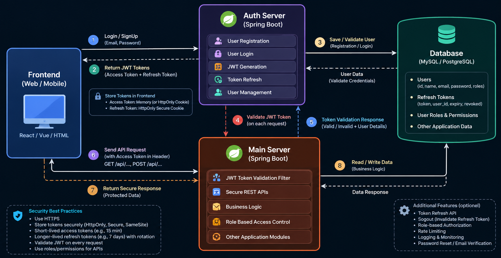

# Secure Authentication Architecture

## Overview

This document describes a secure architecture with a separate **Auth
Server** for authentication and token management, a **Main Server** for
protected business APIs, a frontend client, and a shared database.



## Components

### 1. Frontend --- Web or Mobile

**Examples:** React, Vue, HTML/CSS/JavaScript, or a mobile application.

Responsibilities: - Collect login and signup information. - Call
authentication endpoints. - Send access tokens with protected API
requests. - Handle expired sessions and token refresh. - Display data
returned by the Main Server.

### 2. Auth Server --- Spring Boot

Responsibilities: - Register users and securely hash passwords. -
Authenticate users during login. - Issue short-lived access tokens. -
Manage refresh tokens and token rotation. - Support logout, password
reset, and email verification. - Load user identity, roles, and
permissions when needed.

Example endpoints:

  Method   Endpoint          Purpose
  -------- ----------------- ----------------------------------
  `POST`   `/auth/signup`    Register a user
  `POST`   `/auth/login`     Authenticate and issue tokens
  `POST`   `/auth/refresh`   Refresh an access token
  `POST`   `/auth/logout`    Revoke the refresh-token session

### 3. Main Server --- Spring Boot

Responsibilities: - Expose protected REST APIs. - Validate access tokens
on incoming requests. - Enforce authentication and role/permission-based
authorization. - Execute business logic. - Read and write application
data. - Return only the data the authenticated user is authorized to
access.

Example endpoints:

  -----------------------------------------------------------------------
  Method                  Endpoint                Access
  ----------------------- ----------------------- -----------------------
  `GET`                   `/api/profile`          Authenticated user

  `GET`                   `/api/admin/users`      Admin role

  `GET`                   `/api/orders`           Authenticated user with
                                                  appropriate permissions

  `POST`                  `/api/orders`           Authenticated user with
                                                  appropriate permissions
  -----------------------------------------------------------------------

### 4. Database --- MySQL or PostgreSQL

Possible data: - **Users:** ID, name, email, password hash, status. -
**Refresh-token sessions:** user ID, token hash or identifier, expiry,
revocation status. - **Roles and permissions:** user-role and
role-permission mappings. - **Application data:** domain-specific
records used by the Main Server.

Never store plaintext passwords. Prefer storing refresh-token hashes or
otherwise protecting refresh-token records.

## Request Flow

1.  **Login or signup:** The frontend sends credentials to the Auth
    Server over HTTPS.
2.  **Authenticate:** The Auth Server validates the input and checks the
    user record in the database. For signup, it creates the user after
    validation.
3.  **Issue tokens:** After successful authentication, the Auth Server
    issues an access token and establishes a refresh-token session.
4.  **Call a protected API:** The frontend sends the access token with a
    request to the Main Server, commonly using
    `Authorization: Bearer <access-token>` when using bearer-token
    authentication.
5.  **Validate the access token:** The Main Server validates the token's
    signature, expiry, issuer, audience, and relevant claims. It then
    applies authorization rules.
6.  **Execute business logic:** If authorized, the Main Server processes
    the request and accesses the database as required.
7.  **Return the response:** The Main Server sends the result to the
    frontend. Invalid or missing credentials should receive an
    appropriate `401 Unauthorized`; authenticated users lacking
    permission should receive `403 Forbidden`.
8.  **Refresh when needed:** When the access token expires, the frontend
    uses the refresh flow to obtain a new access token. The Auth Server
    must validate and rotate or revoke refresh tokens according to the
    session design.

## Token Storage and Security

-   Use **HTTPS** for all client-server communication.
-   Keep access tokens short-lived.
-   If using cookies for refresh tokens, configure `HttpOnly`, `Secure`,
    and an appropriate `SameSite` policy; protect cookie-based
    state-changing requests against CSRF.
-   Avoid storing long-lived refresh tokens in browser `localStorage`.
-   Keep signing keys and secrets outside source control; use
    environment configuration or a secrets manager.
-   Validate JWT signature, expiry, issuer, and audience. Do not trust a
    token merely because it can be decoded.
-   Enforce roles and permissions on the server. Hiding a frontend
    button is not authorization.
-   Apply input validation, rate limiting, secure password hashing,
    logging, monitoring, and dependency updates.
-   Revoke refresh-token sessions on logout, password reset, or
    suspected compromise.

## Important Design Decision: How the Main Server Validates Tokens

Choose one consistent validation strategy:

### Option A --- Local JWT validation

The Auth Server signs access tokens. The Main Server validates them
locally using a trusted public key or shared signing secret.

**Advantages:** Low latency and fewer network dependencies per request.

**Requirements:** Secure key distribution and rotation; short token
lifetimes; a clear strategy for permission changes and revocation.

### Option B --- Token introspection

The Main Server asks the Auth Server whether a token is active.

**Advantages:** Centralized token status and easier immediate
revocation.

**Trade-offs:** Adds network latency and makes the Auth Server's
availability important for protected requests. Use authenticated
service-to-service communication and appropriate caching.

For a typical Spring Boot system using JWTs, **local validation with
asymmetric signing keys** is often a good starting point. The Main
Server should not call the Auth Server on every request just to validate
a self-contained JWT unless the architecture deliberately uses
introspection.

## Suggested Implementation Structure

``` text
frontend/
  src/
    api/
    auth/
    components/
    pages/

auth-server/
  src/main/java/.../
    controller/
    service/
    security/
    repository/
    entity/
    dto/

main-server/
  src/main/java/.../
    controller/
    service/
    security/
    repository/
    entity/
    dto/

docs/
  auth-architecture.md
  auth-architecture.png
```

## Summary

The **Auth Server owns identity and token lifecycle**. The **Main Server
owns protected application APIs and business logic**. The frontend
coordinates requests, while the database persists users, sessions,
permissions, and application data. Keep authentication and authorization
enforced on the server, and select a deliberate strategy for
access-token validation and refresh-token revocation.
